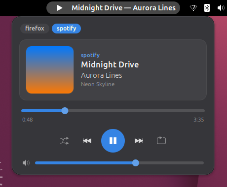
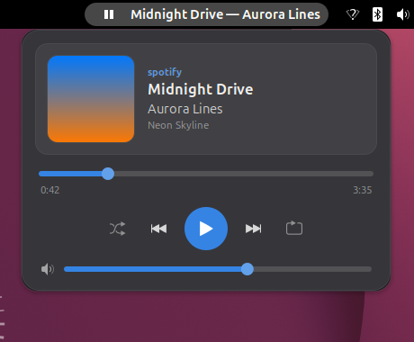

<div align="center">

# 🎵 Cadência

**Controle de mídia para o GNOME Shell, bonito e direto na barra.**
Um indicador discreto com o que está tocando e um popup com capa, progresso, volume e todos os seus players.




</div>

---

## ✨ Funcionalidades

| | Recurso | Detalhe |
|---|---|---|
| 🎧 | **Qualquer player** | Spotify, navegadores (YouTube, SoundCloud...), VLC, mpv, Rhythmbox e tudo que fala MPRIS |
| 🖼️ | **Capa do álbum** | Capas locais e remotas (só `https`, imagens de até 2 MB); ficam em cache em `~/.cache/cadencia` por 14 dias |
| ⏱️ | **Progresso com seek** | Clique ou arraste a barra para pular para qualquer ponto |
| ⏯️ | **Controles completos** | Anterior, tocar/pausar, próxima, aleatório e repetir (faixa ou lista) |
| 🔊 | **Volume por player** | Controle no popup ou role o mouse sobre o indicador |
| 🗂️ | **Vários players** | Chips no topo trocam de player; por padrão vale o que está tocando agora |
| 🖱️ | **Atalhos no indicador** | Clique abre o popup, clique do meio alterna tocar/pausar, rolar muda o volume |
| 🪟 | **Abrir o player** | Clique na capa para trazer a janela do player à frente |
| ⚙️ | **Preferências** | Posição na barra, título, largura máxima, esconder sem player e passo do volume |
| 🎨 | **Visual do Gavetta** | Mesma paleta, cantos arredondados e chips da extensão [Gavetta](https://github.com/bcocheto/gavetta) |

## 📸 Capturas

<table>
  <tr>
    <td align="center"><br><sub>Tocando, com dois players abertos</sub></td>
    <td align="center"><br><sub>Pausado: o ícone da barra muda</sub></td>
  </tr>
</table>

## 📦 Instalação

> Requer **GNOME Shell 50**.

### A partir do código-fonte

```bash
git clone https://github.com/bcocheto/cadencia.git
cd cadencia
make install
```

Em Wayland, saia e entre na sessão para o GNOME encontrar a extensão. Depois:

```bash
gnome-extensions enable cadencia@bcocheto.github.io
```

Para testar sem sair da sessão, use um shell aninhado (precisa do `mutter-dev-bin`):

```bash
make run
```

## 🧩 Como funciona

```
players MPRIS (D-Bus) ──► Manager ──► indicador na barra
                              └─────► popup (capa, progresso, controles, volume)
```

- `mpris.js`: descobre players pelo D-Bus, acompanha mudanças e expõe os comandos.
- `art.js`: resolve a capa (local ou remota com cache).
- `card.js`: o popup.
- `extension.js`: o indicador, o scroll e o clique do meio.

## 🛠️ Desenvolvimento

| Comando | O que faz |
|---|---|
| `make install` | Compila o schema e copia para `~/.local/share/gnome-shell/extensions` |
| `make run` | Shell aninhado para testar |
| `make lint` | Checa a sintaxe, o schema e roda o ESLint (`npm i` antes) |
| `make pack` | Gera `dist/cadencia@bcocheto.github.io.shell-extension.zip` |

## 🗺️ Próximos passos

- [ ] Publicar no extensions.gnome.org
- [ ] Cor de destaque extraída da capa
- [ ] Atalho global para abrir o popup
- [ ] Limpeza automática do cache de capas

## 📄 Licença

[GPL-3.0-or-later](LICENSE) © Breno Cocheto
